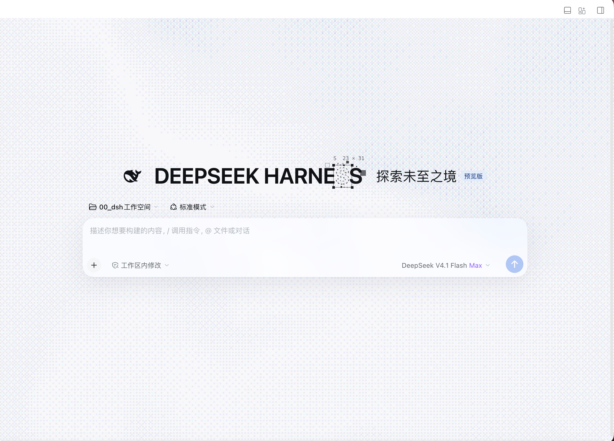
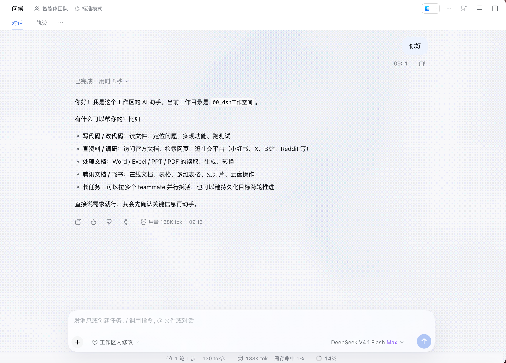

# dsh-signal-field v0.2.11

[](README.md)
[](README_en.md)


DSH（DeepSeek Harness）Web / 桌面端动效界面插件：把「抖动信号场」背景、「蓝图标题」文字动效与「毛玻璃输入框」接进新增会话页与聊天会话页，并把同一套背景与玻璃延伸到 HUD 面板；全部效果都能在「设置 → UI 动画」逐项开关。

> [!NOTE]
> 作用范围只有**新增会话页**与**聊天会话页**两类页面。插件管理页、自动化任务页以及其它面板页保持 DSH 原生外观：v0.1.1 起本插件在这两页上不创建图层、不写作用域属性、不注入样式，切走时会把已经存在的图层与画布一并销毁。
>
> v0.2.0 起再覆盖聊天页的**输入框条带**与 `dsh-awesome-hud` 的**HUD 面板毛玻璃**（右侧边栏背景已于 v0.2.4 按要求移除）。

---

## 演示

**新增会话页（静息态）** —— 抖动信号场背景、「DEEPSEEK HARNESS」蓝图标题、毛玻璃输入框：



**聊天会话页（对话态）** —— 信号场贯穿消息区与输入框条带，输入框卡片呈毛玻璃，底部状态行不受影响：



（浅色主题、2378×1708 截图。动效为实时渲染，静态图展示的是最终观感。）

---

## 效果一览

| 区域 | 背景信号场 | 蓝图标题 | 毛玻璃 |
| --- | --- | --- | --- |
| 新增会话页（`data-content-phase="hero"`） | ✓ | ✓「DEEPSEEK HARNESS」 | ✓ 输入框 |
| 聊天会话页 | ✓（含输入框条带） | — | ✓ 输入框 |
| HUD 面板（`dsh-awesome-hud`，两页通用） | ✓ 透出并模糊 | — | ✓ 面板 |

- 信号场铺满内容区，但**不覆盖**左侧导航栏（保留 DSH 原生填充），避免与 `dsh-better-sidebar` 等插件的配色叠加冲突。
- 亮/暗两套配色自动跟随 DSH 主题：亮色 `#e7e9f0 / #b6bfd8 / 光标擦除`，暗色 `#070a12 / #3a4a7a / 光标点亮`。
- 背景交互：噪声波自走 + 指针拖尾擦除/点亮 + 点击涟漪。
- 标题交互：入场揭示、指针靠近时字形转虚线矢量轮廓（可选选框、拖动字块、飞白微粒）。
- 标题与「鲸鱼图标 + 探索未至之境 + 预览版」同处 hero 行并整体居中；字形可拖到页面任意位置而不会被画布裁切，松手回弹。
- 输入框与 HUD 面板的模糊层都挂在宿主的 `::before` 上，而不是宿主元素本身：`backdrop-filter` 会为该元素建立 `position:fixed` 后代的包含块，写在宿主上会让它子树里的弹层以宿主为视口并被 `overflow:hidden` 裁掉。v0.2.0 的 HUD 面板曾因此把 `dsh-awesome-hud` 自己的 git graph 等弹窗关进了 300px 面板，v0.2.1 修正并加了自动化断言。
- 滚动到输入框下方的消息不再压到状态栏上：v0.2.5 起由**输入框座位自己的 `::before` 背衬**承担遮挡——`backdrop-filter` 模糊 + 底边压色，`z-index:-1` 永远位于卡片与状态栏文字之下，因此不可能糊到任何 UI。v0.2.2 的纯色带、v0.2.3 的 `::after` 模糊层都叠在子元素之上；v0.2.4 改用 `mask` 但挂在了滚动容器上，而座位正是它的子节点——整条座位被一起渐隐（状态栏文字消失），`mask` 建立的 backdrop root 还让输入框卡片采样不到背后的场，毛玻璃退化成能看见噪点的透明卡。v0.2.5 一并修正。
v0.2.7 再把背衬缩小到**只盖「输入框下方那一行信息文字」**那一条（高度由 JS 实测「卡片底边 → 座位底边」得到，写成 `--mui-seat-band-h`）：v0.2.5 铺满整条座位时，`backdrop-filter` 会把抖动的细颗粒平均成一片平滑浅灰，整条输入框区域看起来都像「没有动效背景」，卡片采到的也是糊过的场；现在座位其余部分保持透明，动效背景一直透到输入框区域。
- HUD 面板是浮在内容区右侧的悬浮层，那一带原本没有信号场，玻璃只能模糊到白、看起来像不透明；v0.2.3 起在它背后补一层同样的场，玻璃才有东西可透。v0.2.5 修正两层问题：补场改为插进面板所在的同一层（DSH 的 `shell.overlay`）并排在面板之前（原来挂在 `body` 上用 `z-index:-1`，被外壳底色整块盖住，等于不存在），且尺寸从「面板矩形 + 24px」改为一路铺到视口右下角——面板高度由内容撑出，内容短时它下方原本会露出一块纯白。
v0.2.6 再修两处观感问题：补场原来按「面板外扩 24px」铺，顶上比会话内容区高出一截，右栏于是浮出一块**带硬边的补丁**；左侧那圈外扩又落在内容区之上，两层场叠成一条**发脏的竖带**（亮格 233 → 243、暗格 233 → 218）。现在补场的盒子直接对齐「内容区那条带子」（左缘 = 内容区右缘、上缘 = 内容区上沿、右/下到视口边），并自带一层同源不透明底色（`--mui-surface-base`），重叠处只会被它盖掉，不再叠两层场。
- v0.2.4 起**作用范围不再包含右侧边栏**：右栏的动效背景整块移除（图层、观察器、CSS 与设置项一并删除），右栏回到 DSH 原生外观；设置页总开关数由 11 降为 10。HUD 面板自己那一条竖带仍由补场覆盖（否则面板玻璃无场可模糊、面板下方也露白），面板关闭时补场随之移除。

---

## 设置页

「设置 → UI 动画」（`settings.section` 的 `signal-field`，位置 58）。v0.2.9 起页面分成两个模块，中间一条分割线：

| 模块 | 条目 |
| --- | --- |
| 总开关（模块之上） | 启用全部动效 |
| **页面** | 新建会话页面 / 聊天会话页面（各带一句说明） |
| **动效** | 标题文字默认动效 / 标题文字鼠标交互 / 背景默认动效 / 背景鼠标交互 / 输入框毛玻璃效果 / 背景强度（滑块，默认 **30%**） / 重绘帧率上限（滑块，默认 **30 fps**） |

- 共 **1 个总开关 + 7 个开关 + 2 个滑块**：模块 1 控制「哪些页面展示动效」，模块 2 控制「动效本身」。
- 关掉某一页的开关 = 该页所有效果一起停用（信号场、蓝图标题、输入框毛玻璃），页面回到 DSH 原生外观；「新建会话页面」关闭时标题也不再挂载。
- **HUD 面板毛玻璃没有独立开关**：它跟随「聊天会话页面」开关，关闭聊天页时面板同步回到原生外观；它不受「输入框毛玻璃效果」控制（那个开关只管输入框卡片）。
- 模糊半径固定 14px（v0.2.9 移除了原「毛玻璃模糊」滑块），输入框与 HUD 面板共用。
- **重绘帧率上限**（v0.2.11 新增，15–60 fps，步长 5，默认 **30**）：限制信号场每秒重绘几次来省电，**与画面质感无关**——抖动颗粒的粗细、毛玻璃强度、配色与画布尺寸都不变，变的只是「每秒画几次」。窗口失焦（切到别的应用）时自动降到 8 fps，回到窗口立刻回满；指针在信号场上移动或点击时临时取消限帧约 1.2 秒，避免轨迹出现台阶感。60 Hz 屏默认省掉一半重绘，120 Hz 屏省到 1/4。
- 标题只存在于新增会话页，所以模块 2 的两项标题动效实际只在 hero 生效。
- 模块 1 底部有一行静态说明：动效只在新建会话页与聊天会话页生效，插件管理页/自动化任务页保持 DSH 原生外观。
- 配置写入浏览器 `localStorage`（键 `dsh-signal-field:v1`），重开应用后保持；「恢复默认」可一键清零。旧版「按页 × 按效果」结构会按语义映射到新模型（旧默认强度 55% 会跟随新默认变为 30%，手调过的值保留）。
- 关闭总开关后：画布被销毁、动画停止、注入的作用域属性全部移除，界面回到 DSH 原生外观。

---

## 无障碍与降级

- 系统开启「减少动效」（`prefers-reduced-motion: reduce`）时，首次安装会把「默认动效」与「鼠标交互」初始化为关，设置页给出说明，可手动打开。
- WebGL2 不可用或上下文丢失时，背景降级为一层柔和径向渐变（`[data-mui-field][data-fallback]`），不抖动、不交互，功能不受影响。
- 标题挂载点缺失时，设置页会显示「当前 DSH 版本未找到新增会话页标题挂载点」，其它效果照常。

---

## 安装 / 升级 / 卸载

```text
# 安装（target 为插件包目录的绝对路径）
plugin_manager install_bundle  target=<absolute-path-to-plugin>/dsh-signal-field

# 升级：改完源码后
node scripts/build.mjs        # 重新生成 client.js
# 目录链接安装：刷新页面即可加载新 bundle；package.json / exports 变更时需重新 install_bundle
# 若刷新未生效：plugin_manager set_plugin 关→开，或重启 DeepSeek Harness

# 卸载
plugin_manager remove_bundle  target=dsh-signal-field
```

---

## 已知限制与版本耦合

本插件刻意保持「只读宿主、不改宿主」，但仍依赖几个 DSH 的 DOM 契约。DSH 大版本升级后若动效消失，按下面的锚点表排查：

| 用途 | 依赖的锚点 | 缺失时的行为 |
| --- | --- | --- |
| 页面识别 | `[data-conversation-content]` 是否存在 | 整页不介入：不建图层、不写属性、不挂标题 |
| 新增会话 / 聊天区分 | `[data-conversation-content][data-content-phase]` | 无 `hero` 阶段时按聊天页处理，标题不挂载 |
| 背景图层落点 | 会话内容面 `[data-conversation-content]` 自身 | 不安装背景，其它效果照常 |
| 标题挂载点 | `[data-content-phase="hero"]` 内字号最大的叶子文本块 | 不挂载标题，设置页提示不可用 |
| 标题插入位置 | 从该文本上溯到「父级为纵向 flex」的 hero 行，插在行内文案组之前 | 找不到行结构时不挂载标题 |
| 输入框卡片 | `[data-composer-card]` | 毛玻璃不生效 |
| 输入框条带 | `[data-composer-seat]` 及其对 `--dsw-alias-bg-base` 的引用 | 条带恢复不透明渐变，背景在该处断开 |
| 输入框条带 | `[data-composer-seat]::before` 的模糊 + 底边压色（`z-index:-1`，仅聊天页生效） | 消息滚动到状态栏上不再被遮挡，卡片玻璃仍有真实的场可模糊，状态栏文字不受影响 |
| HUD 面板 | `dsh-awesome-hud` 的 `.hud-panel`（模糊只在 `.hud-panel::before` 上） | 毛玻璃不生效（未安装该插件时无副作用） |
| 暗色主题 | `body[data-ds-dark-theme]` | 固定按亮色配色 |
| 主题取色 | `--dsw-alias-label-primary` / `--dsw-alias-brand-primary` | 回落到插件内置的中性色 |

`[data-conversation-content]` 是本插件唯一的页面判定依据，也是当前的单点依赖（v0.1.1 起不再读取 `ctx.layout`）。


---

## 升级回归清单

1. 新增会话页：鲸鱼图标 / 「DEEPSEEK HARNESS」/「探索未至之境」/「预览版」是否同一行且整体居中。
2. 新增会话页：输入框**下方**是否整片都有动效背景。
3. 聊天会话页：输入框条带是否不再有白色底，背景是否一直铺到页面底部；输入框卡片的毛玻璃观感是否与新增会话页一致（v0.2.5 修正了 mask 破坏 backdrop-filter 导致的「透明卡」）。
4. 聊天会话页上下滚动消息：文字是否**不再压到状态栏**上；输入框下方的状态栏文字（「工作区修改」「模型名」那两行）是否**完整可见、不透明、不发虚**（v0.2.5 的重点回归项）。
5. 展开提问卡片 / 计划清单等浮层：浮层下方是否**没有被任何东西遮挡或模糊**（v0.2.4 的重点回归项）。
6. 右侧边栏：应回到 DSH 原生外观，**不再有**信号场背景。
7. HUD 面板：是否呈毛玻璃、能否透出并模糊背后信号场；面板**下方**那一竖条是否也是动效背景、而不是一块纯白（v0.2.5 的重点回归项）；面板四周是否**没有**硬边补丁、也没有比周围更密的竖带（v0.2.6 的重点回归项）；关掉「HUD 面板毛玻璃」后是否复原、补场是否一并消失。
8. HUD 自带的弹层（git graph、分支 / 提交 / 确认弹窗、文件操作与分支菜单、commit 悬停提示）是否仍按视口居中或贴合触发位置，**没有被关进面板或被裁切**。
9. 拖动标题到页面四角与输入框上方：文字是否始终可见、松手是否回弹。
10. 回归：两页背景/标题/输入框毛玻璃、明暗主题切换、设置页 8 个开关与 2 个滑块即时生效并刷新后保持；插件管理页与自动化任务页仍保持 DSH 原生外观。
11. 总开关关闭后：`document.documentElement` 上不应残留 `data-mui*` 属性，`<style data-plugin="dsh-signal-field:styles">` 应被移除。
12. 设置页结构（v0.2.9）：只剩「页面」与「动效」两个模块 + 一条分割线；关掉「聊天会话页面」后聊天页回原生外观、HUD 面板同步失去毛玻璃；背景强度默认显示 30%。
13. 省电回归（v0.2.11）：默认「重绘帧率上限 30 fps」下，画面观感应与 60 fps 无可见差别；切到别的应用再切回来，背景应无缝恢复、不跳帧也不静止；在信号场上快速划动指针，轨迹应仍然跟手（交互期临时取消限帧）。自检文本末尾的 `--- performance ---` 段会输出实测 `fps` / `avgRenderMs` / `renders` / `skips`，可直接对照。

---

## 开发

```text
node scripts/build.mjs     # src/*.js → client.js（零依赖，内置语法与残留检查）
node --test test/*.test.mjs
```

> 量化验收：设置页自检文本末尾的 `--- performance ---` 段会输出信号场与 HUD 补场的实测帧率、平均单帧渲染耗时与跳帧数（v0.2.11 起）。在没有浏览器控制权的情况下，这段数字是判断「限帧」与「失焦降频」是否真的生效的唯一硬证据。

```text
dsh-signal-field/
├── package.json          # bundle 行 + client 入口 + exports + files
├── cordis.patch.yml      # insert: signal-field
├── index.js              # Host 侧空 apply（能力全在 Client）
├── client.js             # 构建产物，勿手改
├── icon.svg              # Bayer 阵点 + 消失点图标
├── locale/{zh,en}.json   # meta（插件管理器显示）+ runtime（设置页文案）
├── src/
│   ├── settings.js       # 默认值/归一化/钳位/store（纯函数，可单测）
│   ├── page.js           # 页面分类与跨区域作用域（纯函数）
│   ├── glsl.js           # 顶点 + 波纹 + 抖动着色器
│   ├── field.js          # WebGL2 信号场引擎
│   ├── techtext.js       # Canvas2D 蓝图标题引擎
│   ├── styles.js         # 注入样式
│   ├── stage.js          # 锚点解析与装配
│   ├── settings-page.js  # 「UI 动画」设置页
│   └── client.js         # 模块入口
├── scripts/build.mjs
├── test/{settings,page,techtext,hero-layout,build,wiring,frame-pace,sync-coalesce}.test.mjs
└── docs/dom-anchors.md
```

`src/*.js` 的书写约定（构建脚本会校验）：`import` 单行且以 `;` 结束；只用具名 `export`；所有文件共享一个闭包，顶层标识符不能重名。

---

## 许可

MIT。
