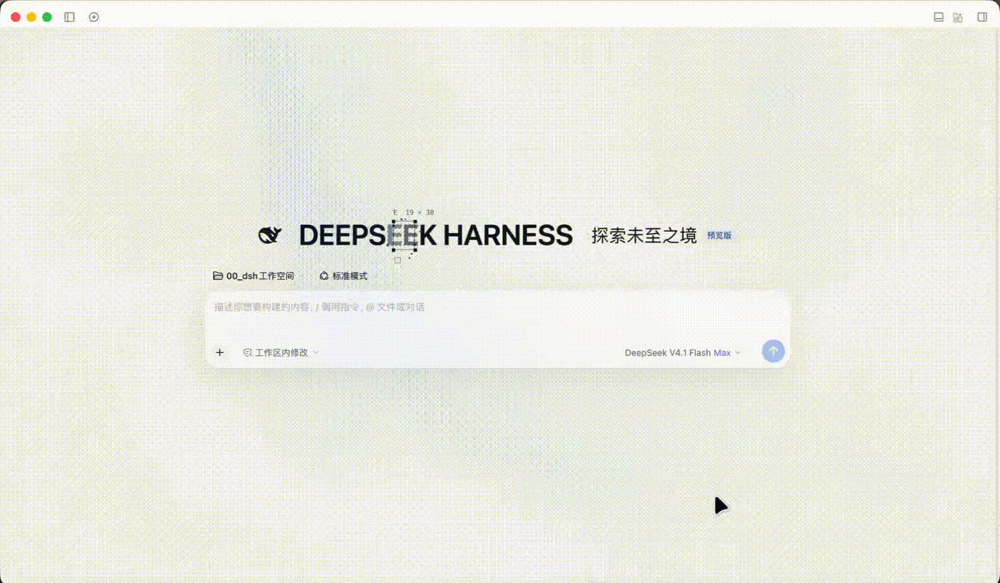
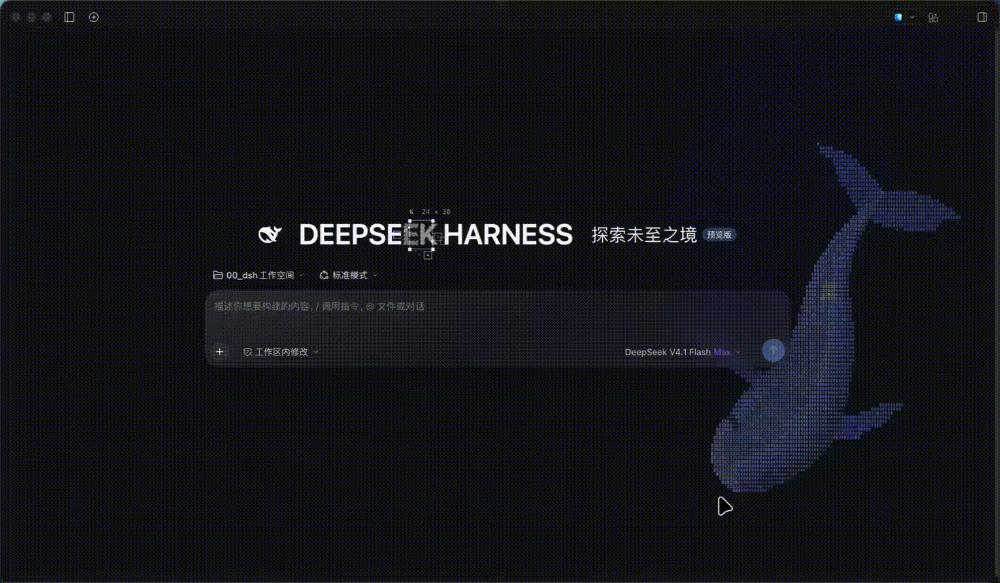

# dsh-signal-field v0.5.0

[](README.md)
[](README_en.md)


DSH（DeepSeek Harness）Web / 桌面端动效界面插件：把「抖动信号场」背景、「蓝图标题」文字动效、「毛玻璃输入框」与「ASCII 鲸鱼动画」接进新增会话页与聊天会话页，并把同一套背景与玻璃延伸到 HUD 面板。v0.5.0 起设置页**按页面组织**：两页各自一套开关与参数，都能在「设置 → UI 动画」逐项调整。

> [!TIP]
> 本插件的鲸鱼动画基于 **[dsh-ascii-whales](https://github.com/Chael-Chael/dsh-ascii-whales)** 制作，感谢原作者 **Chael-Chael** 的开源工作。上游来源、许可与改编范围的完整说明见 [THIRD_PARTY_NOTICES.md](THIRD_PARTY_NOTICES.md)。

> [!NOTE]
> 作用范围只有**新增会话页**与**聊天会话页**两类页面。插件管理页、自动化任务页以及其它面板页保持 DSH 原生外观：v0.1.1 起本插件在这两页上不创建图层、不写作用域属性、不注入样式，切走时会把已经存在的图层与画布一并销毁。
>
> v0.2.0 起再覆盖聊天页的**输入框条带**与 `dsh-awesome-hud` 的**HUD 面板毛玻璃**（右侧边栏背景已于 v0.2.4 按要求移除）。

---

## 演示

**浅色主题**



**深色主题**



---

## 效果一览

| 区域 | 背景信号场 | ASCII 鲸鱼 | 蓝图标题 | 毛玻璃 |
| --- | --- | --- | --- | --- |
| 新增会话页（`data-content-phase="hero"`） | ✓ | ✓ 可关 | ✓「DEEPSEEK HARNESS」 | ✓ 输入框 |
| 聊天会话页 | ✓（含输入框条带） | — | — | ✓ 输入框 |
| HUD 面板（`dsh-awesome-hud`，两页通用） | ✓ 透出并模糊 | — | — | ✓ 面板 |

- 信号场铺满内容区，但**不覆盖**左侧导航栏（保留 DSH 原生填充），避免与 `dsh-better-sidebar` 等插件的配色叠加冲突。
- 聊天页里的「轨迹」「统计」等视图与「对话」共用同一个会话内容容器，**同样铺信号场**（聊天页背景开关打开时）。统计视图本身没有底色；轨迹视图则**有三层**自带 `background: var(--dsw-alias-bg-layer-1)` 的容器（视图根 → 分栏容器 → 表格本体），少清一层都看不到信号场。宿主给这类视图根统一打了 `data-conversation-composer-overlay` 标记，v0.5.0 起插件按「视图根 + 其内部带 `data-trajectory-scroll` 的分栏容器 + 表格本体」三处只清**背景色**，信号场因此在三个视图下表现一致；视图内部的工具栏、时间线图块等自带底色的控件保持原样（与聊天页的消息卡片一致）。
- 亮/暗两套配色自动跟随 DSH 主题：亮色 `#e7e9f0 / #b6bfd8 / 光标擦除`，暗色 `#070a12 / #3a4a7a / 光标点亮`。
- 背景交互：噪声波自走 + 指针拖尾擦除/点亮 + 点击涟漪。
- **ASCII 鲸鱼**（v0.4.0 从 `dsh-ascii-whales` 迁移）：新增会话页里的一层字符海洋——鲸鱼摆尾巡游、鱼群集群与追逃、尾迹扩散，全部用等宽字形拼出来。它**只在新会话页**出现，且与信号场**叠加**（信号场在下、鲸鱼在上；鲸鱼画布透明，所以是「鲸鱼游在抖动天空前」），两者开关彼此独立。
- 标题交互：入场揭示、指针靠近时字形转虚线矢量轮廓（可选选框、拖动字块、飞白微粒）。
- 标题与「鲸鱼图标 + 探索未至之境 + 预览版」同处 hero 行并整体居中；字形可拖到页面任意位置而不会被画布裁切，松手回弹。
- 输入框与 HUD 面板的模糊层都挂在宿主的 `::before` 上，而不是宿主元素本身：`backdrop-filter` 会为该元素建立 `position:fixed` 后代的包含块，写在宿主上会让它子树里的弹层以宿主为视口并被 `overflow:hidden` 裁掉。v0.2.0 的 HUD 面板曾因此把 `dsh-awesome-hud` 自己的 git graph 等弹窗关进了 300px 面板，v0.2.1 修正并加了自动化断言。
- 滚动到输入框下方的消息不再压到状态栏上：v0.2.5 起由**输入框座位自己的 `::before` 背衬**承担遮挡——`backdrop-filter` 模糊 + 底边压色，`z-index:-1` 永远位于卡片与状态栏文字之下，因此不可能糊到任何 UI。v0.2.2 的纯色带、v0.2.3 的 `::after` 模糊层都叠在子元素之上；v0.2.4 改用 `mask` 但挂在了滚动容器上，而座位正是它的子节点——整条座位被一起渐隐（状态栏文字消失），`mask` 建立的 backdrop root 还让输入框卡片采样不到背后的场，毛玻璃退化成能看见噪点的透明卡。v0.2.5 一并修正。
v0.2.7 再把背衬缩小到**只盖「输入框下方那一行信息文字」**那一条（高度由 JS 实测「卡片底边 → 座位底边」得到，写成 `--mui-seat-band-h`）：v0.2.5 铺满整条座位时，`backdrop-filter` 会把抖动的细颗粒平均成一片平滑浅灰，整条输入框区域看起来都像「没有动效背景」，卡片采到的也是糊过的场；现在座位其余部分保持透明，动效背景一直透到输入框区域。
- HUD 面板是浮在内容区右侧的悬浮层，那一带原本没有信号场，玻璃只能模糊到白、看起来像不透明；v0.2.3 起在它背后补一层同样的场，玻璃才有东西可透。v0.2.5 修正两层问题：补场改为插进面板所在的同一层（DSH 的 `shell.overlay`）并排在面板之前（原来挂在 `body` 上用 `z-index:-1`，被外壳底色整块盖住，等于不存在），且尺寸从「面板矩形 + 24px」改为一路铺到视口右下角——面板高度由内容撑出，内容短时它下方原本会露出一块纯白。
v0.2.6 再修两处观感问题：补场原来按「面板外扩 24px」铺，顶上比会话内容区高出一截，右栏于是浮出一块**带硬边的补丁**；左侧那圈外扩又落在内容区之上，两层场叠成一条**发脏的竖带**（亮格 233 → 243、暗格 233 → 218）。现在补场的盒子直接对齐「内容区那条带子」（左缘 = 内容区右缘、上缘 = 内容区上沿、右/下到视口边），并自带一层同源不透明底色（`--mui-surface-base`），重叠处只会被它盖掉，不再叠两层场。
- v0.2.4 起**作用范围不再包含右侧边栏**：右栏的动效背景整块移除（图层、观察器、CSS 与设置项一并删除），右栏回到 DSH 原生外观；设置页总开关数由 11 降为 10。HUD 面板自己那一条竖带仍由补场覆盖（否则面板玻璃无场可模糊、面板下方也露白），面板关闭时补场随之移除。
- **HUD 补场的交互与出现时机**（v0.3.1）：补场与内容区共用同一个「背景鼠标交互」开关——指针扫过面板背后那条竖带时同样有拖尾擦除（亮色）/ 点亮（暗色），点击同样出涟漪（窄条内会被容器裁切，属预期）。补场**不播入场揭示**，进入聊天会话页时直接满强度显示；内容区仍保留原 1.8s 揭示与 0.5s 淡入。v0.5.0 起补场与面板毛玻璃都跟随**当前所在页的「UI动效总开关」+「背景」开关**（在新建会话页听新建页的，在聊天页听聊天页的）：该页背景关掉后没有可模糊的内容，补场与玻璃一起回到原生外观；「输入框毛玻璃」开关只管输入框卡片，不影响面板。

---

## 设置页

「设置 → UI 动画」（`settings.section` 的 `signal-field`，位置 58）。v0.5.0 起改成**按页面组织**的三张卡片：

| 卡片 | 内容 |
| --- | --- |
| **总开关** | 启用全部动效（开关）+ 分割线 + 动画重绘帧率上限（滑块，默认 **30 fps**） |
| **新建会话页** | UI动效总开关 → 背景 → 标题文字 → 鲸鱼 → 输入框毛玻璃效果 |
| **聊天会话页** | UI动效总开关 → 背景 → 输入框毛玻璃效果（该页没有标题与鲸鱼） |

两张页面卡片内部结构一致：**效果开关**一行，紧跟一行默认折叠的**「…动效设置」**，点开才是细节参数；块与块之间用分割线隔开（新建页 4 条、聊天页 2 条、总开关 1 条，共 7 条）。

| 块 | 开关 | 折叠区里的参数 |
| --- | --- | --- |
| 背景 | 该页是否显示信号场 | 背景默认动效（自走/静止）/ 背景鼠标交互 / 背景强度（默认 **30%**）/ 背景动画速度（默认 **1×**） |
| 标题文字（仅新建页） | 是否启用插件蓝图标题（关闭回 DSH 原生标题） | 标题文字默认动效 / 标题文字鼠标交互 / 标题动画速度（默认 **1×**） |
| 鲸鱼（仅新建页） | 是否显示 ASCII 鲸鱼 | 鲸鱼种类（座头鲸 / 虎鲸）+ 11 个数值项（两列数字输入框） |
| 输入框毛玻璃 | 该页输入框是否毛玻璃 | —（模糊半径固定 14px） |

- **两页完全独立**：关掉「聊天会话页 → 背景」不影响新建会话页，反之亦然；背景参数（交互 / 强度 / 速度）也各页一份，可以把聊天页调得更淡。
- **折叠区默认收起、各自独立可多开**；展开状态不写存储，重新进入设置页会回到全折叠。
- 上级开关关着时，折叠区**仍可展开查看**，但内部控件置灰并提示「先打开上方开关」；页面总开关与全局总开关自身保持可点，否则关掉就再也打不开。
- **重绘帧率上限**（v0.2.11 新增，15–60 fps，步长 5，默认 **30**；v0.5.0 移入「总开关」卡片）：限制**信号场与鲸鱼**每秒重绘几次来省电，**与画面质感无关**——抖动颗粒的粗细、毛玻璃强度、配色与画布尺寸都不变，变的只是「每秒画几次」。窗口失焦（切到别的应用）时信号场自动降到 8 fps，回到窗口立刻回满；指针在信号场上移动或点击时临时取消限帧约 1.2 秒。鲸鱼是**按真实时间推进**的：降帧只减少绘制次数，不会让它游得更慢。
- 标题只存在于新增会话页，所以「标题文字」块只在新建会话页卡片里出现；鲸鱼同理。
- **HUD 面板没有独立开关**：补场与面板毛玻璃跟随**当前所在页的「UI动效总开关」+「背景」开关**——在新建会话页看新建页的开关，在聊天页看聊天页的开关；该页背景关掉后没有可模糊的内容，两者一起回到原生外观。它**不**受「输入框毛玻璃」开关控制（那个开关只管输入框卡片）。
- 作用范围：动效只在新建会话页与聊天会话页生效，插件管理页、自动化任务页等其它面板页保持 DSH 原生外观。这条规则由插件行为与本文档体现——v0.2.10 起设置页**不再**显示那条静态说明。
- 配置写入浏览器 `localStorage`（键 `dsh-signal-field:v1`），重开应用后保持；「恢复默认」可一键清零。
- 关闭总开关后：画布被销毁、动画停止、注入的作用域属性全部移除，界面回到 DSH 原生外观。

### 从 v0.4.x 升级（设置结构 v3）

v0.5.0 把设置结构从「页面开关 × 全局效果参数」改成「按页面组织」，**旧调参不再迁移**：升级后除「启用全部动效」与「动画重绘帧率上限」保留原值外，两页总开关、背景/标题/鲸鱼参数与毛玻璃开关全部回默认（背景强度 30%、速度 1×、鲸鱼出厂参数）。这是刻意的取舍——旧值没有明确的「属于哪一页」语义，硬映射只会造出用户没设过的组合。降级回 v0.4.x 则表现为「全部开启 + 默认参数」，不会崩。

### 鲸鱼动画（v0.4.0，从 `dsh-ascii-whales` 迁移）

只迁移了「鲸鱼动画」本身与下表这些可配置项；海洋颜色、眼睛底色、彩色闪烁、玻璃开关、字体来源与本地字体扫描**都不在本插件里**，一律固定为迁移当时的值（DeepSeek 蓝 `#4d6bfe`、眼睛跟随主色、关闭彩色闪烁）。

字符风格**固定 ASCII**，不提供图形字/汉字/Kanji 切换，因此也只内嵌一套等宽字体子集。

| 行标题 | 默认 | 范围 / 步长 | 说明 |
| --- | --- | --- | --- |
| 鲸鱼（效果开关） | 开 | — | 这一层的总开关：全局总开关、新建会话页总开关、鲸鱼开关三者都开才渲染 |
| 鲸鱼种类 | 座头鲸 | 座头鲸 / 虎鲸 | 虎鲸体型略小并带白色斑纹 |
| 鲸鱼数量 | **1** | 1–20 / 1 | 多于 1 条时逐条按 1 / 0.7 / 0.84 / 0.77 / 0.65 / 0.9 递减 |
| 鲸鱼游动速度 | **0.5** | 0.1–10 / 0.05 | 时钟倍率 |
| 鲸鱼身体摆动幅度 | **0.75** | 0–3 / 0.05 | 脊柱波幅 |
| 鲸鱼转弯灵活度 | **0.8** | 0.1–3 / 0.05 | 转向响应 |
| 鲸鱼摆尾频率 | **0.85** | 0.1–5 / 0.05 | 尾鳍拍动频率 |
| 鲸鱼大小 | **1.5** | 0.1–10 / 0.1 | 单条基准尺寸 |
| 鲸鱼透明度 | **0.5** | 0–1 / 0.05 | 整层不透明度 |
| 鲸鱼字符栅格（倍） | **0.5** | 0.1–10 / 0.05 | 越小格子越细、字越多，开销也越高 |
| 鲸鱼底纹网格透明度 | **0.1** | 0–1 / 0.01 | 字格背底的格线，设 0 即隐藏 |
| 鲸鱼小鱼数量 | **188** | 0–1000 / 1 | 鱼群规模，设 0 即没有鱼群 |
| 鲸鱼尾迹强度 | **1** | 0–10 / 0.1 | 游动后留下的余痕 |

- 默认值 = 迁移当时在 `dsh-ascii-whales` 里的实际取值，**不是**它的出厂默认（出厂是 3 条鲸鱼、1.2 倍大小、170 条小鱼等）。
- 改「鲸鱼种类 / 鲸鱼数量 / 鲸鱼大小 / 鲸鱼字符栅格 / 鲸鱼小鱼数量」会**重建整片海洋**（实例与尺寸绑在构造期）；其余参数是热更新，拖动时不会重播。
- 鲸鱼的鼠标交互**跟随「背景鼠标交互」开关**：开着时指针经过有鱼群追逃、点击有水花；关掉后不再注册任何指针监听。
- 鲸鱼**不响应**系统的「减少动效」偏好，始终按配置帧率运行（这是刻意选择，与标题/信号场的处理不同）。

---

## 无障碍与降级

- 系统开启「减少动效」（`prefers-reduced-motion: reduce`）时，首次安装会把「默认动效」与「鼠标交互」初始化为关，设置页给出说明，可手动打开。**鲸鱼是例外**：它不读这个偏好，始终按配置帧率运行；不想看就关掉新建会话页卡片里的「鲸鱼」开关。
- WebGL2 不可用或上下文丢失时，背景降级为一层柔和径向渐变（`[data-mui-field][data-fallback]`），不抖动、不交互，功能不受影响。
- Canvas2D 不可用时鲸鱼**静默降级**：图层仍然挂上，但不创建引擎、不报错、不拖垮信号场与标题（图层上留 `data-whale-fallback` 便于排查）。
- 标题挂载点缺失时，设置页会显示「当前 DSH 版本未找到新增会话页标题挂载点」，其它效果照常。

---

## 安装 / 升级 / 卸载

```text
# 安装（target 为插件包目录的绝对路径）
plugin_manager install_bundle  target=<absolute-path-to-plugin>/dsh-signal-field

# 升级：改完源码后
node scripts/build.mjs        # 重新生成 client.js
# 目录链接安装：刷新页面即可加载新 bundle；package.json / exports 变更时需重新 install_bundle
# 若刷新未生效：plugin_manager set_plugin 关→开，或重启 DeepSeek Harness

# 卸载
plugin_manager remove_bundle  target=dsh-signal-field
```

### 从 GitHub / Release 安装（无需 npm 账号）

```sh
# 方式一：GitHub 依赖（锁定版本 tag，需本机有 git）
dsh plugin --profile web add "github:Ycet/dsh-signal-field#v0.5.0"

# 方式二：Release 资产 tarball（无需 git）
dsh plugin --profile web add "https://github.com/Ycet/dsh-signal-field/releases/download/v0.5.0/dsh-signal-field-0.5.0.tgz"

# 桌面端把 --profile web 换成 --profile desktop（使用桌面端自带 CLI）
```

---

## 已知限制与版本耦合

本插件刻意保持「只读宿主、不改宿主」，但仍依赖几个 DSH 的 DOM 契约。DSH 大版本升级后若动效消失，按下面的锚点表排查：

| 用途 | 依赖的锚点 | 缺失时的行为 |
| --- | --- | --- |
| 页面识别 | `[data-conversation-content]` 是否存在 | 整页不介入：不建图层、不写属性、不挂标题 |
| 新增会话 / 聊天区分 | `[data-conversation-content][data-content-phase]` | 无 `hero` 阶段时按聊天页处理，标题不挂载 |
| 背景图层落点 | 会话内容面 `[data-conversation-content]` 自身 | 不安装背景，其它效果照常 |
| 鲸鱼图层 | 同上；鲸鱼图层 `[data-mui-whale]` 追加为内容面的最后一个子节点 | 不安装鲸鱼，其它效果照常 |
| 鲸鱼内嵌字体 | `@font-face` 的 `Whales Mono` 子集 | 回落到系统等宽字体，轮廓会偏但动画照常 |
| 鲸鱼渲染 | Canvas2D（`getContext("2d")`） | 静默降级，不画鲸鱼 |
| 标题挂载点 | `[data-content-phase="hero"]` 内字号最大的叶子文本块 | 不挂载标题，设置页提示不可用 |
| 标题插入位置 | 从该文本上溯到「父级为纵向 flex」的 hero 行，插在行内文案组之前 | 找不到行结构时不挂载标题 |
| 输入框卡片 | `[data-composer-card]` | 毛玻璃不生效 |
| 输入框条带 | `[data-composer-seat]` 及其对 `--dsw-alias-bg-base` 的引用 | 条带恢复不透明渐变，背景在该处断开 |
| 输入框条带 | `[data-composer-seat]::before` 的模糊 + 底边压色（`z-index:-1`，仅聊天页生效） | 消息滚动到状态栏上不再被遮挡，卡片玻璃仍有真实的场可模糊，状态栏文字不受影响 |
| HUD 面板 | `dsh-awesome-hud` 的 `.hud-panel`（模糊只在 `.hud-panel::before` 上） | 毛玻璃不生效（未安装该插件时无副作用） |
| HUD 补场与玻璃的开关 | 当前所在页的「UI动效总开关」+「背景」开关（v0.5.0 起） | 当前页背景关闭时补场与玻璃一起回到原生外观 |
| 暗色主题 | `body[data-ds-dark-theme]` | 固定按亮色配色 |
| 主题取色 | `--dsw-alias-label-primary` / `--dsw-alias-brand-primary` | 回落到插件内置的中性色 |
| 会话视图根（轨迹 / 统计） | 视图根上的 `[data-conversation-composer-overlay]` 标记 | 不做透明处理：轨迹视图的自带白底会盖住信号场（统计视图不受影响） |

`[data-conversation-content]` 是本插件唯一的页面判定依据，也是当前的单点依赖（v0.1.1 起不再读取 `ctx.layout`）。


---

## 升级回归清单

1. 新增会话页：鲸鱼图标 / 「DEEPSEEK HARNESS」/「探索未至之境」/「预览版」是否同一行且整体居中。
2. 新增会话页：输入框**下方**是否整片都有动效背景。
3. 聊天会话页：输入框条带是否不再有白色底，背景是否一直铺到页面底部；输入框卡片的毛玻璃观感是否与新增会话页一致（v0.2.5 修正了 mask 破坏 backdrop-filter 导致的「透明卡」）。
4. 聊天会话页上下滚动消息：文字是否**不再压到状态栏**上；输入框下方的状态栏文字（「工作区修改」「模型名」那两行）是否**完整可见、不透明、不发虚**（v0.2.5 的重点回归项）。
5. 展开提问卡片 / 计划清单等浮层：浮层下方是否**没有被任何东西遮挡或模糊**（v0.2.4 的重点回归项）。
6. 右侧边栏：应回到 DSH 原生外观，**不再有**信号场背景。
7. HUD 面板：是否呈毛玻璃、能否透出并模糊背后信号场；面板**下方**那一竖条是否也是动效背景、而不是一块纯白（v0.2.5 的重点回归项）；面板四周是否**没有**硬边补丁、也没有比周围更密的竖带（v0.2.6 的重点回归项）；关掉**当前所在页**的「背景」或整页「UI动效总开关」后是否复原、补场是否一并消失（v0.5.0 起两者由当前页的同一组开关控制；新建会话页同样适用）。
8. HUD 自带的弹层（git graph、分支 / 提交 / 确认弹窗、文件操作与分支菜单、commit 悬停提示）是否仍按视口居中或贴合触发位置，**没有被关进面板或被裁切**。
9. 拖动标题到页面四角与输入框上方：文字是否始终可见、松手是否回弹。
10. 回归：两页背景/标题/输入框毛玻璃、明暗主题切换、设置页各项开关与滑块即时生效并刷新后保持；插件管理页与自动化任务页仍保持 DSH 原生外观。
11. 总开关关闭后：`document.documentElement` 上不应残留 `data-mui*` 属性，`<style data-plugin="dsh-signal-field:styles">` 应被移除。
12. 设置页结构（v0.5.0）：三张卡片依次为「总开关 / 新建会话页 / 聊天会话页」，卡片内共 7 条分割线（1 / 4 / 2）；「…动效设置」默认折叠、可独立展开、可多开；帧率滑块在总开关卡片里；两页同名开关互不影响。关掉当前页「背景」后补场与面板毛玻璃一起消失（新建页与聊天页都适用），关掉「输入框毛玻璃」则面板玻璃不受影响。背景强度默认显示 30%。**深色主题下「鲸鱼种类」的选中项文字必须清晰可见**（v0.4.1 修过一次白底白字）。
13. 省电回归（v0.2.11）：默认「重绘帧率上限 30 fps」下，画面观感应与 60 fps 无可见差别；切到别的应用再切回来，背景应无缝恢复、不跳帧也不静止；在信号场上快速划动指针，轨迹应仍然跟手（交互期临时取消限帧）。自检文本末尾的 `--- performance ---` 段会输出实测 `fps` / `avgRenderMs` / `renders` / `skips`，可直接对照。
14. 速度回归（v0.3.0）：两个速度滑块默认 1× 时观感应与 v0.2.11 完全一致。拖动「标题动画速度」时，扫光应平滑地变快/变慢且**位置不跳**、标题**不闪不重播**；拖动「背景动画速度」时波形、涟漪摆动与扩散应同步变速，HUD 补场同步；把背景速度拉满并同时把帧率压到 15 fps，允许变顿但不允许画面撕裂或静止。自检文本的 `speeds: title=…x background=…x` 一行应与滑块值一致。
15. 补场回归（v0.3.1）：进入聊天会话页时，**面板背后那条竖带应立即满强度出现**，不再有「先纯色、再从中心向外扩散」的几秒等待；内容区仍保留 1.8s 揭示与 0.5s 淡入（两者观感不同是刻意的）。指针扫过补场条带应有拖尾、点击应有涟漪；关掉「背景鼠标交互」后补场与内容区应同时停止响应；面板没有几何（如刚打开、尺寸为 0）时补场应暂停而不是继续空转。
16. 鲸鱼回归（v0.4.0）：新增会话页应出现与 `dsh-ascii-whales` 同款的鲸鱼，**图层压在信号场之上、正文之下**，标题与输入框不被遮挡；聊天会话页**不应**出现鲸鱼。逐项拧「鲸鱼种类 / 数量 / 大小 / 字符栅格 / 小鱼数量」应重建海洋且观感正确，拧其余 6 项应热更新而不重播。关掉新建页卡片里的「鲸鱼」后画布应立即消失，重新打开应恢复；关掉「背景鼠标交互」后鲸鱼不再响应指针；把「动画重绘帧率上限」压到 15 fps，鲸鱼应仍是**同样的速度**、只是更卡（不允许变慢）。切到别的应用：信号场降到 8 fps，鲸鱼应随页面隐藏暂停。若同时装着 `dsh-ascii-whales` 并开启它的「显示海洋」，会出现两层鲸鱼——这是两者独立渲染的预期结果。
18. 会话视图回归（v0.5.0）：聊天页切到「轨迹」「统计」时同样能看到信号场（聊天页背景开关打开时），切回「对话」不应出现图层重建的闪烁；关掉聊天页背景后三个视图一起回到原生外观；「轨迹」视图里的工具栏与时间线图块仍保持自己原有的底色。
17. 按页模型回归（v0.5.0）：分别在两张页面卡片里关掉「背景」，各自页面的信号场应独立消失、另一页不受影响；折叠区在效果关着时仍可展开且控件置灰；「恢复默认」后回到两页全开、强度 30%、速度 1×。从 v0.4.x 升级后，除总开关与帧率外的参数应回到默认（这是预期，不是 bug）。

---

## 开发

```text
node scripts/build.mjs     # src/*.js → client.js（零依赖，内置语法与残留检查）
node --test test/*.test.mjs
```

> 量化验收：设置页自检文本末尾的 `--- performance ---` 段会输出信号场与 HUD 补场的实测帧率、平均单帧渲染耗时与跳帧数（v0.2.11 起）。在没有浏览器控制权的情况下，这段数字是判断「限帧」与「失焦降频」是否真的生效的唯一硬证据。

```text
dsh-signal-field/
├── package.json          # bundle 行 + client 入口 + exports + files
├── cordis.patch.yml      # insert: signal-field
├── index.js              # Host 侧空 apply（能力全在 Client）
├── client.js             # 构建产物，勿手改
├── icon.svg              # Bayer 阵点 + 消失点图标
├── locale/{zh,en}.json   # meta（插件管理器显示）+ runtime（设置页文案）
├── THIRD_PARTY_NOTICES.md # 鲸鱼引擎/字体/上游改编的第三方来源与许可
├── src/
│   ├── settings.js       # 默认值/归一化/钳位/store（纯函数，可单测）
│   ├── page.js           # 页面分类、跨区域作用域、鲸鱼可见性（纯函数）
│   ├── glsl.js           # 顶点 + 波纹 + 抖动着色器
│   ├── field.js          # WebGL2 信号场引擎
│   ├── techtext.js       # Canvas2D 蓝图标题引擎
│   ├── whale-fonts.js    # 鲸鱼等宽字体子集（data URI）
│   ├── whale-engine.js   # 鲸鱼引擎（上游移植段包在 IIFE 里 + 5 处适配）
│   ├── whale-field.js    # 鲸鱼图层适配器（生命周期 + 设置差异比对）
│   ├── styles.js         # 注入样式
│   ├── stage.js          # 锚点解析与装配
│   ├── settings-page.js  # 「UI 动画」设置页
│   └── client.js         # 模块入口
├── scripts/build.mjs
├── test/{settings,settings-page,page,techtext,hero-layout,parity,glass-contain,migration,build,wiring,frame-pace,sync-coalesce,speed,title-speed,hud-backdrop,whale-settings,whale-view,whale-source}.test.mjs
└── docs/dom-anchors.md
```

`src/*.js` 的书写约定（构建脚本会校验）：`import` 单行且以 `;` 结束；只用具名 `export`；所有文件共享一个闭包，顶层标识符不能重名。鲸鱼移植段是例外：它被 IIFE 包住，因此 `clamp` 这类重名不会与插件自身冲突——`whale-source.test.mjs` 会校验这个边界。

---

## 许可

MIT（见 [LICENSE](LICENSE)）。

鲸鱼动画引擎、等宽字体子集与上游改编的第三方来源、版权与许可见 [THIRD_PARTY_NOTICES.md](THIRD_PARTY_NOTICES.md)。
本插件的 MIT 许可**不重新许可**上游源码。
