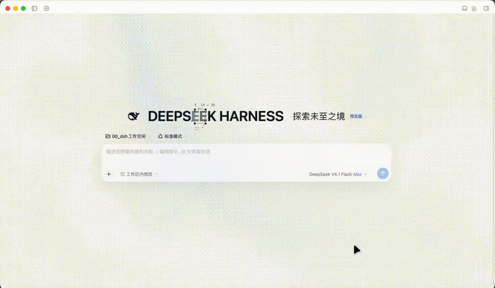
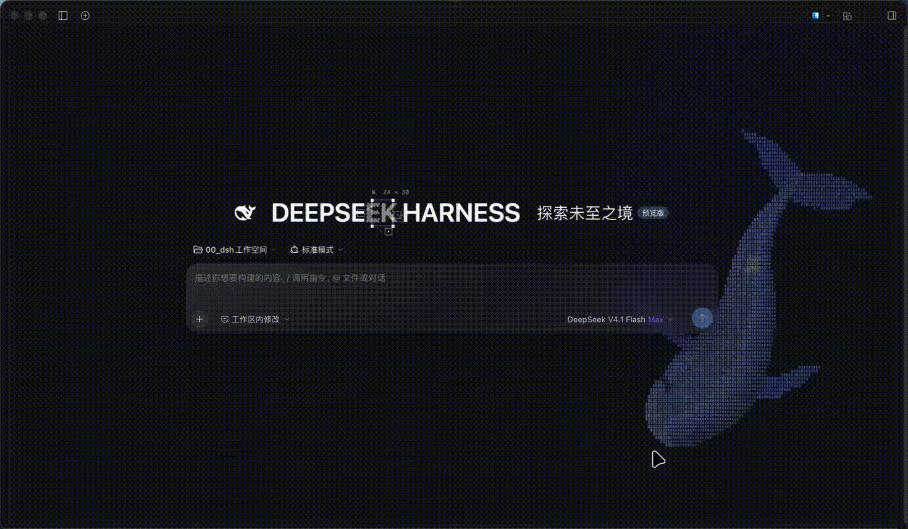

# dsh-signal-field v0.5.1

[](README.md)
[](README_en.md)


An animated-UI plugin for DeepSeek Harness (DSH) on Web and desktop: it brings a dithered signal-field backdrop, a blueprint headline type effect, frosted-glass composer surfaces and an ASCII whale animation to the new-session page and chat sessions, and extends the same backdrop and glass to the HUD panel. Since v0.5.0 the settings page is **organised per page**: each page owns its own switches and parameters; since v0.5.1 the **whales work on both pages**, with a separate set of parameters per page, all under Settings → UI Motion.

> [!TIP]
> The whale animation in this plugin is based on **[dsh-ascii-whales](https://github.com/Chael-Chael/dsh-ascii-whales)** — thanks to its author **Chael-Chael** for open-sourcing it. Full upstream attribution, licences and the list of adaptations are in [THIRD_PARTY_NOTICES.md](THIRD_PARTY_NOTICES.md).

> [!NOTE]
> The scope is exactly two kinds of page: the **new session** page and the **chat session** page. The plugin manager, the scheduled-task page and any other panel page keep the stock DSH look: since v0.1.1 the plugin creates no layer, writes no scope attribute and injects nothing there, and it destroys an existing layer and canvas when you navigate away.
>
> Since v0.2.0 it also covers the chat page **composer strip** and the `dsh-awesome-hud` **HUD panel glass** (the right sidebar backdrop was removed in v0.2.4).

---

## Demo

**Light Mode**



**Dark Mode**



---

## What you get

| Area | Signal field | ASCII whales | Blueprint headline | Frosted glass |
| --- | --- | --- | --- | --- |
| New session (`data-content-phase="hero"`) | ✓ | ✓ optional | ✓ "DEEPSEEK HARNESS" | ✓ composer |
| Chat session | ✓ (composer strip included) | — | — | ✓ composer |
| HUD panel (`dsh-awesome-hud`, both pages) | ✓ shows through, blurred | — | — | ✓ panel |

- The field spans the content area but deliberately does **not** repaint the left navigation column: DSH keeps its own fill, so colour stacking with plugins such as `dsh-better-sidebar` stays predictable.
- The chat page's **Trace** and **Statistics** views share the same session content container as the transcript, so they get the **same backdrop and whales** (whenever the matching switches are on). The statistics view has no fill of its own; the trajectory view has **three** containers that paint `background: var(--dsw-alias-bg-layer-1)` (view root → split container → table itself), and leaving any one of them opaque hides the backdrop. The host marks such view roots with `data-conversation-composer-overlay`, and since v0.5.0 the plugin clears only the **background colour** of those three (the marked root, the split container identified by its `data-trajectory-scroll` child, and the table itself), so the backdrop behaves identically in all three views; opaque controls inside the view (toolbar, timeline plot) keep their own surfaces, just like message cards on the transcript.
- Light and dark palettes follow the DSH theme automatically: light `#e7e9f0 / #b6bfd8 / cursor erase`, dark `#070a12 / #3a4a7a / cursor reveal`.
- Backdrop interaction: drifting noise wave + pointer-trail erase/reveal + click ripple.
- **ASCII whales** (migrated from `dsh-ascii-whales` in v0.4.0, available on both pages since v0.5.1): a layer of living characters — whales cruise with beating tails, small fish school, chase and flee, and wakes diffuse, all drawn from monospace glyphs. It **stacks** with the signal field (field underneath, whales on top; the whale canvas is transparent, so it reads as whales swimming in front of a dithered sky), and the two switches are independent; the new-session and chat pages each keep **their own whale switch and parameters**.
- The chat page's **Trace** and **Statistics** sub-views share the same `[data-conversation-content]` as the transcript, so the **whales appear in all three views** (when that page's whale switch is on). Their view roots paint an opaque fill; the plugin clears it whenever the page has *any* live motion layer, so `html[data-mui-active]` is driven by "backdrop **or** whales" and whale-only setups work too.
- Headline interaction: entry reveal, glyphs turn into dashed vector outlines near the pointer, with an optional selection frame, draggable letter blocks and drifting specks.
- The headline shares the hero row with the whale mark, "探索未至之境" and the preview badge, and the whole row is centred; letter blocks can be dragged anywhere on the page without being clipped, and spring back on release.
- Both the composer and the HUD panel hang their blur on the host's `::before`, never on the host element itself: `backdrop-filter` turns that element into the containing block for its `position:fixed` descendants, so putting it on the host makes the popups inside that subtree resolve against the host and get clipped by its `overflow:hidden`. In v0.2.0 this trapped `dsh-awesome-hud`'s own git graph and other dialogs inside the 300px panel; v0.2.1 fixes it and pins the rule with automated assertions.
- Messages scrolling under the composer no longer land on the status row: since v0.2.5 the **composer seat grows its own `::before` backing** — a `backdrop-filter` blur plus a bottom-edge tint at `z-index:-1`, so it always paints *below* the card and the status-row text and can never blur any UI. The v0.2.2 colour band and the v0.2.3 `::after` blur both painted above the seat's children; v0.2.4 switched to a `mask` but put it on the scroll container, and the seat is a child of it — the whole seat faded out (the status-row text vanished), and the backdrop root created by the mask stopped the composer card from sampling the signal field, degrading the glass to a transparent card with visible noise. Both are fixed in v0.2.5.
v0.2.7 shrinks that backing to **only the info line below the composer** (height measured at runtime as "card bottom → seat bottom" and exposed as `--mui-seat-band-h`): with the v0.2.5 full-seat layer, `backdrop-filter` averaged the fine dither into a smooth pale grey, so the whole composer strip looked like it had no animated backdrop at all and the card blurred an already-smoothed field. The rest of the seat is transparent again, so the backdrop shows all the way into the composer area.
- The HUD panel floats over the right-hand side of the content area, where there was no signal field, so its glass could only blur flat white and looked opaque. Since v0.2.3 a matching field layer is placed behind the panel, and v0.2.5 fixes two things about it: the layer is now inserted into the panel's own layer (DSH's `shell.overlay`) immediately before the panel (it used to hang on `body` with `z-index:-1`, where the shell's opaque background covered it completely), and its box now runs to the bottom-right corner of the viewport instead of "panel rect + 24px" — the panel's height follows its content, so a short panel used to leave a plain white block underneath.
v0.2.6 fixes two remaining artefacts: the layer used to be laid out as "panel rect + 24px", so it started above the conversation area and the right column showed a **hard-edged rectangular patch**; that 24px overhang also landed on top of the conversation area, stacking two signal fields into a **dirty vertical band** (light cell 233 → 243, dark cell 233 → 218). The box is now aligned to the *content band* itself (left = content-area right edge, top = content-area top edge, right/bottom = viewport edges) and carries its own opaque same-source base (`--mui-surface-base`), so any overlap is covered instead of composited twice.
- Since v0.2.4 the **right sidebar is out of scope**: its animated backdrop is removed entirely (layer, observers, CSS and the setting), so the sidebar keeps the stock DSH look; the switch count drops from 11 to 10. The vertical strip the HUD panel itself occupies is still covered by its backdrop layer (otherwise the panel has nothing to blur and a white block appears beneath it); that layer disappears with the panel.
- **HUD backing field: interaction and timing** (v0.3.1): it shares the same "Backdrop pointer interaction" switch as the content area — sweeping across the strip behind the panel gives the same cursor erase (light theme) / light-up (dark theme) trail, and clicking gives the same ripple (clipped by the narrow container, which is expected). It does **not** play the entry reveal at all, so it renders at full strength the moment you open a chat session; the content area keeps its original 1.8 s reveal and 0.5 s fade. Since v0.5.0 the backing field and the panel glass both follow the **current page's "UI motion master switch" + "Backdrop" switch** (the new-session page's on the new-session page, the chat page's on the chat page): with that page's backdrop off there is nothing to blur, so both revert to the stock look; the "Composer frosted glass" switch only governs the composer card.

---

## Settings page

Settings → UI Motion (a `settings.section` entry with id `signal-field`, order 58). Since v0.5.0 the page is **organised per page** in three cards:

| Card | Content |
| --- | --- |
| **Master switch** | Enable all effects (switch) + divider + animation redraw cap (slider, **30 fps** by default) |
| **New session page** | UI motion master switch → Backdrop → Headline → Whales → Composer frosted glass |
| **Chat session page** | UI motion master switch → Backdrop → Whales (new in v0.5.1) → Composer frosted glass (still no headline on this page) |

Both page cards share the same shape: one **effect switch** row, immediately followed by a collapsible **"… motion settings"** row that is collapsed by default and holds the fine-tuning parameters; blocks are separated by dividers (4 on the new-session card, 3 on the chat card, 1 in the master card — 8 in total).

| Block | Switch | Parameters inside the collapsed section |
| --- | --- | --- |
| Backdrop | whether this page shows the signal field | Backdrop default motion (drift/static) / Backdrop pointer interaction / Backdrop intensity (**30%** by default) / Backdrop animation speed (**1×** by default) |
| Headline (new-session page only) | whether the plugin blueprint headline is used (off restores the stock headline) | Headline default motion / Headline pointer interaction / Headline animation speed (**1×**) |
| Whales (one set per page) | whether this page shows the ASCII whale layer | Whale species (humpback / orca) + 11 number fields (two-column number inputs) |
| Composer frosted glass | whether this page's composer is frosted | — (blur radius fixed at 14px) |

- **The two pages are fully independent**: turning "Chat session page → Backdrop" off leaves the new-session page untouched and vice versa; backdrop parameters (interaction / intensity / speed) are also per page, so the chat backdrop can be made fainter.
- **Collapsed sections start closed and open independently (several may be open at once)**; the open state is not persisted, so re-entering the settings page collapses everything again.
- While a parent switch is off the collapsed section **can still be opened for inspection**, but its controls are disabled and a "turn the switch above on first" note is shown; the page master switch and the global master switch themselves stay clickable, otherwise turning them off would be a one-way trip.
- **Animation redraw cap** (new in v0.2.11; 15–60 fps, step 5, **30** by default; moved into the Master switch card in v0.5.0) limits how many times per second the **signal field and the whales** redraw in order to save power. It is **independent of image quality**: grain size, glass strength, colours and canvas size are unchanged — only the draw rate moves. While the window is unfocused it drops to 8 fps and returns to the configured value the moment the window regains focus; while the pointer moves or clicks on the field it is temporarily uncapped for about 1.2 s. The whales advance on **wall-clock time**, so a lower cap only draws them less often — it never makes them swim slower.
- The headline only exists on the new session page, which is why the "Headline" block only appears on the new-session card; the whales exist on both pages, each with its own parameters.
- **The HUD panel has no switch of its own**: its backing field and glass follow the **current page's "UI motion master switch" + "Backdrop" switch** — the new-session page's switches on the new-session page, the chat page's on the chat page; with that page's backdrop off there is nothing to blur, so both revert to the stock look. It is *not* controlled by the "Composer frosted glass" switch (that switch only governs the composer card).
- Scope: the effects run only on the new session and chat pages; the plugin manager, the automation page and any other panel page keep the stock DSH look. That rule is expressed by the plugin's behaviour and by this document — since v0.2.10 the settings page **no longer** shows a static note about it.
- Stored in browser `localStorage` under `dsh-signal-field:v1` and restored after a restart; "Restore defaults" clears it.
- Turning the master switch off destroys the canvas, stops animation and removes every injected scope attribute, restoring the stock DSH look.

### Upgrading from v0.5.0 (same schema, additive key only)

v0.5.1 only adds one group — the chat page's whales (`pages.chat.whale`) — to the existing v3 schema. It **does not bump the schema and does not reset anything**: every stored backdrop/headline/glass parameter survives, and the chat page's whales are filled in with defaults (on by default, same default set as the new-session page). Turn it off under "Chat session page → Whales" if you don't want it; the two pages' whale parameters are fully independent, so one can stay faint while the other is dense. Downgrading to v0.5.0 merely drops that group — nothing else changes.

### Upgrading from v0.4.x (settings schema v3)

v0.5.0 reshapes the settings from "page switches × global effect parameters" into a per-page structure, and **old tuning is not migrated**: after the upgrade only "Enable all effects" and "Animation redraw cap" keep their old values; both page switches, every backdrop/headline/whale parameter and the glass switches fall back to defaults (backdrop intensity 30%, speed 1×, factory whale parameters). That is deliberate — old values have no well-defined "which page do they belong to" meaning, and a forced mapping would invent combinations the user never chose. Downgrading to v0.4.x shows "everything on + defaults" instead, and never crashes.

### Whale animation (migrated in v0.4.0, available on both pages since v0.5.1)

Only the animation itself and the rows below were migrated. Ocean colour, eye background, colourful shimmer, the glass switch, font source and local font scanning are **not** part of this plugin and stay fixed at their migration-time values (DeepSeek blue `#4d6bfe`, eye following the main colour, colourful shimmer off).

The character style is **fixed to ASCII** — there is no graphic-rune / Hanzi / Kanji switch, and only a single monospace subset is embedded.

| Row | Default | Range / step | Notes |
| --- | --- | --- | --- |
| Whales (effect switch) | on | — | the layer's own switch: the global master switch, the new-session page master switch and this switch must all be on |
| Whale species | humpback | humpback / orca | orca is slightly smaller with white markings |
| Whale count | **1** | 1–20 / 1 | with more than one, sizes step down by 1 / 0.7 / 0.84 / 0.77 / 0.65 / 0.9 |
| Whale swim speed | **0.5** | 0.1–10 / 0.05 | clock multiplier |
| Whale body swing | **0.75** | 0–3 / 0.05 | spine wave amplitude |
| Whale turn agility | **0.8** | 0.1–3 / 0.05 | steering response |
| Whale tail frequency | **0.85** | 0.1–5 / 0.05 | tail-beat rate |
| Whale size | **1.5** | 0.1–10 / 0.1 | base size per whale |
| Whale opacity | **0.5** | 0–1 / 0.05 | whole-layer opacity |
| Whale cell size (x) | **0.5** | 0.1–10 / 0.05 | smaller means finer cells, more glyphs and more cost |
| Whale grid opacity | **0.1** | 0–1 / 0.01 | the grid behind the glyphs; 0 hides it |
| Whale fish count | **188** | 0–1000 / 1 | school size; 0 removes the fish |
| Whale wake intensity | **1** | 0–10 / 0.1 | the fading trail left behind |

- The defaults equal the values actually in use in `dsh-ascii-whales` at migration time, **not** its factory defaults (factory: 3 whales, 1.2× size, 170 fish, and so on).
- Changing whale species / count / size / cell size / fish count **rebuilds the whole ocean** (instances and sizes are bound at construction time); the other parameters update in place and never replay while you drag.
- Whale pointer interaction **follows the "Backdrop pointer interaction" switch**: with it on, the pointer scatters and attracts the fish and a click splashes; with it off no pointer listener is registered at all.
- Whales **ignore** the system "reduce motion" preference and always run at the configured frame rate (a deliberate choice, unlike the headline and the field).

---

## Accessibility and degradation

- With `prefers-reduced-motion: reduce`, the first install seeds "idle motion" and "pointer interaction" as off; the settings page explains this and lets you turn them back on. **Whales are the exception**: they never read that preference and always run at the configured frame rate — turn the "Whales" switch on the new-session card off if you do not want them.
- Without WebGL2, or after context loss, the backdrop degrades to a soft radial gradient (`[data-mui-field][data-fallback]`): no dithering, no interaction, nothing else breaks.
- Without Canvas2D the whales **degrade silently**: the layer is still mounted but no engine is created — no error, no impact on the field or the headline (the layer carries `data-whale-fallback` for diagnosis).
- If no headline mount point exists, the settings page says so and every other effect keeps working.

---

## Install / upgrade / remove

```text
# install (target is the absolute path of the plugin package directory)
plugin_manager install_bundle  target=<absolute-path-to-plugin>/dsh-signal-field

# upgrade after editing sources
node scripts/build.mjs        # regenerate client.js
# the profile links this directory: a page refresh loads the new bundle;
# re-run install_bundle only when package.json / exports change.
# If a refresh is not enough: toggle the plugin off/on, or restart DeepSeek Harness.

# remove
plugin_manager remove_bundle  target=dsh-signal-field
```

### Install from GitHub / a Release asset (no npm account)

```sh
# Option 1: GitHub dependency (pinned to a release tag; requires git)
dsh plugin --profile web add "github:Ycet/dsh-signal-field#v0.5.1"

# Option 2: Release asset tarball (no git required)
dsh plugin --profile web add "https://github.com/Ycet/dsh-signal-field/releases/download/v0.5.1/dsh-signal-field-0.5.1.tgz"

# Desktop: replace --profile web with --profile desktop (using the desktop-bundled CLI)
```

---

## Known limits and version coupling

The plugin only reads the host and never mutates DSH state, but it does depend on a few DOM contracts. If the effects disappear after a DSH upgrade, check this table:

| Purpose | Anchor | Behaviour when missing |
| --- | --- | --- |
| Page detection | presence of `[data-conversation-content]` | the whole page is out of scope: no layer, no attributes, no headline |
| New session vs chat | `[data-conversation-content][data-content-phase]` | without a `hero` phase it is treated as chat and no headline is mounted |
| Backdrop layer host | the conversation surface `[data-conversation-content]` itself | no backdrop; everything else works |
| Whale layer | same host; the `[data-mui-whale]` layer is appended as the last child of the surface | no whales; everything else works |
| Session sub-views (transcript / trace / stats) | same host (all three share one content surface, so switching views never rebuilds the layer) | whales and backdrop stay on the current view; nothing else breaks |
| Whale embedded font | the `Whales Mono` `@font-face` subset | falls back to a system monospace face: outlines drift but animation keeps running |
| Whale rendering | Canvas2D (`getContext("2d")`) | silent degradation, no whales drawn |
| Headline mount point | the largest-font leaf text block inside `[data-content-phase="hero"]` | no headline; the settings page reports it |
| Headline insertion point | climb to the hero row whose parent is a column flex container, then insert before the text group | no headline when the row cannot be located |
| Composer card | `[data-composer-card]` | no frosted glass |
| Composer strip | `[data-composer-seat]` and its use of `--dsw-alias-bg-base` | the opaque strip returns and the backdrop breaks there |
| Composer strip | `blur + bottom tint` on `[data-composer-seat]::before` (`z-index:-1`, chat phase only) | messages no longer scroll over the status row, the card still blurs the real field, and the status-row text stays untouched |
| HUD panel | `.hud-panel` from `dsh-awesome-hud` (the blur lives on `.hud-panel::before` only) | no frosted glass (harmless when that plugin is absent) |
| Dark theme | `body[data-ds-dark-theme]` | light palette only |
| Palette tokens | `--dsw-alias-label-primary` / `--dsw-alias-brand-primary` | built-in neutral fallback colours |
| Conversation view root (trace / stats) | the `[data-conversation-composer-overlay]` marker on the view root | no transparency applied: the trajectory view's own white layer covers the backdrop (the statistics view is unaffected) |

`[data-conversation-content]` is the plugin's only page-detection source and therefore its single point of failure (since v0.1.1 it no longer reads `ctx.layout`).


---

## Upgrade regression checklist

1. New session: the whale mark, "DEEPSEEK HARNESS", "探索未至之境" and the preview badge sit on one centred row.
2. New session: the area **below** the composer is covered by the backdrop.
3. Chat session: the composer strip is no longer white, the backdrop runs to the bottom of the page, and the composer card reads as the same frosted glass as on the new-session page (v0.2.5 fixed the "transparent card" caused by the mask breaking backdrop-filter).
4. Chat session, scrolling the transcript: message text **no longer overlaps the status row**, and the status-row text below the composer (the workspace and model lines) is **fully visible, opaque and crisp** (the key v0.2.5 regression).
5. Expanding a question card / plan list: nothing covers or blurs the area beneath the overlay (the key v0.2.4 regression).
6. Right sidebar: back to the stock DSH look, with **no** signal field.
7. HUD panel: it reads as frosted glass and the signal field shows through blurred; the strip of the right-hand column **below** the panel is backdrop rather than a plain white block (the key v0.2.5 regression); there is **no** hard-edged patch and **no** denser band around the panel (the key v0.2.6 regression); turning the **current page's** "Backdrop" (or its "UI motion master switch") off restores the original look and removes that backdrop layer (since v0.5.0 both share the current page's gates; this applies on the new-session page as well).
8. The HUD's own popups (git graph, branch/commit/confirm dialogs, file and branch menus, commit hover tip) are still centred in or anchored to the viewport — **not trapped inside the panel and not clipped**.
9. Drag the headline to the page corners and over the composer: it stays visible and springs back on release.
10. Regression: backdrops/headline/composer glass on both pages, light/dark switching, every switch and slider applying immediately and surviving a refresh; the plugin manager and scheduled-task page still keep the stock DSH look.
11. With the master switch off: no `data-mui*` attribute remains on `document.documentElement`, and `<style data-plugin="dsh-signal-field:styles">` is gone.
12. Settings structure (v0.5.0, extended in v0.5.1): three cards in the order "Master switch / New session page / Chat session page" with exactly 8 dividers between the blocks (1 / 4 / 3); each "… motion settings" section starts collapsed, opens independently and several may be open at once; the frame-rate slider lives in the master card; the same-named switches on the two page cards do not affect each other. Turning the current page's "Backdrop" off makes the backing field and the panel glass disappear together (on both the new-session and the chat page), while turning "Composer frosted glass" off leaves the panel glass alone. Backdrop intensity shows 30% by default. **In the dark theme the selected "Whale species" segment must stay readable** (v0.4.1 fixed a white-on-white case).
13. Power regression (v0.2.11): at the default "30 fps" cap the picture should be visually indistinguishable from 60 fps; focus another app and come back — the backdrop resumes seamlessly with no jump and no freeze; flick the pointer quickly across the field and the trail still tracks the cursor (the cap is lifted during interaction). The `--- performance ---` block at the end of the self-check text reports measured `fps` / `avgRenderMs` / `renders` / `skips` for direct comparison.
14. Speed regression (v0.3.0): at the default 1× on both sliders the look must match v0.2.11 exactly. Dragging "Headline animation speed" should speed the sweep up and down smoothly **without the runner jumping position**, and the headline must **not flicker or replay**; dragging "Backdrop animation speed" should move wave, ripple wobble and ripple spread together, with the HUD backing field following. Crank the backdrop speed to 2× while capping redraws at 15 fps — choppiness is acceptable, tearing or a frozen picture is not. The `speeds: title=…x background=…x` line in the self-check text must match the slider values.
15. HUD backing-field regression (v0.3.1): opening a chat session must show the strip behind the panel **at full strength immediately**, with no "flat colour first, then a reveal spreading out from the centre" delay; the content area keeps its 1.8 s reveal and 0.5 s fade (the two looking different is intentional). Sweeping across the strip should leave a trail and clicking should ripple; turning "Backdrop pointer interaction" off must stop both the strip and the content area at once; while the panel has no geometry (just opened, zero size) the strip must pause rather than keep animating.
16. Whale regression (v0.4.0 / v0.5.1): the new-session page shows the same whales as `dsh-ascii-whales`, **layered above the signal field and below the content**, with the headline and composer unobstructed; the **chat session must show whales too** (v0.5.1, with independent switches and parameters per page), and they must survive switching to the "Trace" and "Statistics" views. Turning whale species / count / size / cell size / fish count should rebuild the ocean correctly, and the other six should update in place without replay. Turning one page card's "Whales" switch off must remove that page's canvas at once (leaving the other page untouched) and turning it back on must restore it; turning "Backdrop pointer interaction" off must stop the pointer response; capping redraws at 15 fps must keep the **same speed** and only look choppier (never slower). Focus another app: the field drops to 8 fps while the whales pause with the hidden page. If `dsh-ascii-whales` is also installed with its own ocean enabled you will see two whale layers — expected, since the two plugins render independently.
17. Per-page model regression (v0.5.0): turning "Backdrop" off in each page card hides only that page's signal field and leaves the other page untouched; a collapsed section stays openable while the effect is off, with its controls disabled; "Restore defaults" returns both pages to on, 30% intensity and 1× speeds. After upgrading from v0.4.x every parameter except the master switch and the frame rate resets to defaults — that is expected, not a bug.
18. Conversation-view regression (v0.5.0 / v0.5.1): switching the chat page to "Trace" or "Statistics" still shows the backdrop and the whales (when the matching switches are on), and switching back to "Transcript" must not flicker from a rebuilt layer; **with only the whales on and the backdrop off, the whales must still be visible in all three views** (the view fills are cleared via `data-mui-active`, which is driven by "backdrop or whales"); turning the chat page backdrop and whales off reverts all three views to the stock look; the trajectory toolbar and timeline plot keep their own surfaces.

---

## Development

```text
node scripts/build.mjs     # src/*.js -> client.js (zero dependencies, built-in syntax and leftover checks)
node --test test/*.test.mjs
```

> Quantitative check: the `--- performance ---` block at the end of the settings page's self-check text reports measured frame rate, mean per-frame render cost and skipped frames for the signal field and the HUD backing field (since v0.2.11). With no browser control available, those numbers are the only hard evidence that the redraw cap and the unfocused drop really work.

```text
dsh-signal-field/
├── package.json          # bundle row + client entry + exports + files
├── cordis.patch.yml      # insert: signal-field
├── index.js              # Host-side no-op apply (all capability lives on the Client)
├── client.js             # build output, do not edit by hand
├── icon.svg              # Bayer dot + vanishing-point icon
├── locale/{zh,en}.json   # meta (plugin manager) + runtime (settings copy)
├── THIRD_PARTY_NOTICES.md # third-party sources and licences for the whale engine / font
├── src/
│   ├── settings.js       # defaults / normalisation / clamping / store (pure, unit-tested)
│   ├── page.js           # page classification, cross-area scope, whale visibility (pure)
│   ├── glsl.js           # vertex + wave + dither shaders
│   ├── field.js          # WebGL2 signal-field engine
│   ├── techtext.js       # Canvas2D blueprint headline engine
│   ├── whale-fonts.js    # the whale monospace subset (data URI)
│   ├── whale-engine.js   # whale engine (upstream block inside an IIFE + 5 adaptations)
│   ├── whale-field.js    # whale layer adapter (lifecycle + settings diffing)
│   ├── styles.js         # injected styles
│   ├── stage.js          # anchor resolution and wiring
│   ├── settings-page.js  # the "UI Motion" settings page
│   └── client.js         # module entry
├── scripts/build.mjs
├── test/{settings,settings-page,page,techtext,hero-layout,parity,glass-contain,migration,build,wiring,frame-pace,sync-coalesce,speed,title-speed,hud-backdrop,whale-settings,whale-view,whale-source}.test.mjs
└── docs/dom-anchors.md
```

`src/*.js` conventions (enforced by the build script): imports are single-line and end with `;`; named `export` only; every file shares one closure, so top-level identifiers must stay unique. The whale port is the exception: it sits inside an IIFE, so collisions such as `clamp` can never clash with the plugin's own code — `whale-source.test.mjs` pins that boundary.

---

## License

MIT (see [LICENSE](LICENSE)).

Third-party sources, copyright notices and licences for the whale animation engine and the embedded monospace subset are listed in [THIRD_PARTY_NOTICES.md](THIRD_PARTY_NOTICES.md). This plugin's MIT licence **does not relicense** upstream sources.
