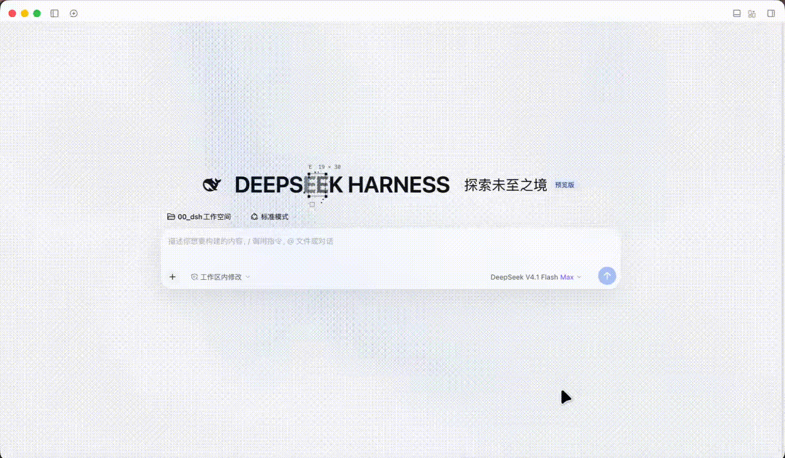
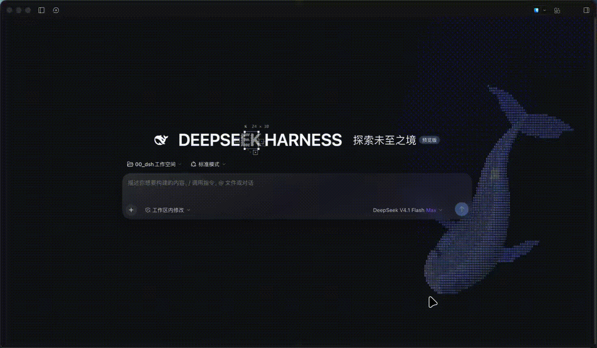

# dsh-signal-field v0.4.0

[](README.md)
[](README_en.md)


An animated-UI plugin for DeepSeek Harness (DSH) on Web and desktop: it brings a dithered signal-field backdrop, a blueprint headline type effect, frosted-glass composer surfaces and an ASCII whale animation to the new-session page and chat sessions, and extends the same backdrop and glass to the HUD panel — each toggleable under Settings → UI Motion.

> [!NOTE]
> The scope is exactly two kinds of page: the **new session** page and the **chat session** page. The plugin manager, the scheduled-task page and any other panel page keep the stock DSH look: since v0.1.1 the plugin creates no layer, writes no scope attribute and injects nothing there, and it destroys an existing layer and canvas when you navigate away.
>
> Since v0.2.0 it also covers the chat page **composer strip** and the `dsh-awesome-hud` **HUD panel glass** (the right sidebar backdrop was removed in v0.2.4).

---

## Demo

**Light Mode**



**Dark Mode**



---

## What you get

| Area | Signal field | ASCII whales | Blueprint headline | Frosted glass |
| --- | --- | --- | --- | --- |
| New session (`data-content-phase="hero"`) | ✓ | ✓ optional | ✓ "DEEPSEEK HARNESS" | ✓ composer |
| Chat session | ✓ (composer strip included) | — | — | ✓ composer |
| HUD panel (`dsh-awesome-hud`, both pages) | ✓ shows through, blurred | — | — | ✓ panel |

- The field spans the content area but deliberately does **not** repaint the left navigation column: DSH keeps its own fill, so colour stacking with plugins such as `dsh-better-sidebar` stays predictable.
- Light and dark palettes follow the DSH theme automatically: light `#e7e9f0 / #b6bfd8 / cursor erase`, dark `#070a12 / #3a4a7a / cursor reveal`.
- Backdrop interaction: drifting noise wave + pointer-trail erase/reveal + click ripple.
- **ASCII whales** (migrated from `dsh-ascii-whales` in v0.4.0): a layer of living characters on the new-session page — whales cruise with beating tails, small fish school, chase and flee, and wakes diffuse, all drawn from monospace glyphs. It appears **only on the new-session page** and **stacks** with the signal field (field underneath, whales on top; the whale canvas is transparent, so it reads as whales swimming in front of a dithered sky). The two switches are independent.
- Headline interaction: entry reveal, glyphs turn into dashed vector outlines near the pointer, with an optional selection frame, draggable letter blocks and drifting specks.
- The headline shares the hero row with the whale mark, "探索未至之境" and the preview badge, and the whole row is centred; letter blocks can be dragged anywhere on the page without being clipped, and spring back on release.
- Both the composer and the HUD panel hang their blur on the host's `::before`, never on the host element itself: `backdrop-filter` turns that element into the containing block for its `position:fixed` descendants, so putting it on the host makes the popups inside that subtree resolve against the host and get clipped by its `overflow:hidden`. In v0.2.0 this trapped `dsh-awesome-hud`'s own git graph and other dialogs inside the 300px panel; v0.2.1 fixes it and pins the rule with automated assertions.
- Messages scrolling under the composer no longer land on the status row: since v0.2.5 the **composer seat grows its own `::before` backing** — a `backdrop-filter` blur plus a bottom-edge tint at `z-index:-1`, so it always paints *below* the card and the status-row text and can never blur any UI. The v0.2.2 colour band and the v0.2.3 `::after` blur both painted above the seat's children; v0.2.4 switched to a `mask` but put it on the scroll container, and the seat is a child of it — the whole seat faded out (the status-row text vanished), and the backdrop root created by the mask stopped the composer card from sampling the signal field, degrading the glass to a transparent card with visible noise. Both are fixed in v0.2.5.
v0.2.7 shrinks that backing to **only the info line below the composer** (height measured at runtime as "card bottom → seat bottom" and exposed as `--mui-seat-band-h`): with the v0.2.5 full-seat layer, `backdrop-filter` averaged the fine dither into a smooth pale grey, so the whole composer strip looked like it had no animated backdrop at all and the card blurred an already-smoothed field. The rest of the seat is transparent again, so the backdrop shows all the way into the composer area.
- The HUD panel floats over the right-hand side of the content area, where there was no signal field, so its glass could only blur flat white and looked opaque. Since v0.2.3 a matching field layer is placed behind the panel, and v0.2.5 fixes two things about it: the layer is now inserted into the panel's own layer (DSH's `shell.overlay`) immediately before the panel (it used to hang on `body` with `z-index:-1`, where the shell's opaque background covered it completely), and its box now runs to the bottom-right corner of the viewport instead of "panel rect + 24px" — the panel's height follows its content, so a short panel used to leave a plain white block underneath.
v0.2.6 fixes two remaining artefacts: the layer used to be laid out as "panel rect + 24px", so it started above the conversation area and the right column showed a **hard-edged rectangular patch**; that 24px overhang also landed on top of the conversation area, stacking two signal fields into a **dirty vertical band** (light cell 233 → 243, dark cell 233 → 218). The box is now aligned to the *content band* itself (left = content-area right edge, top = content-area top edge, right/bottom = viewport edges) and carries its own opaque same-source base (`--mui-surface-base`), so any overlap is covered instead of composited twice.
- Since v0.2.4 the **right sidebar is out of scope**: its animated backdrop is removed entirely (layer, observers, CSS and the setting), so the sidebar keeps the stock DSH look; the switch count drops from 11 to 10. The vertical strip the HUD panel itself occupies is still covered by its backdrop layer (otherwise the panel has nothing to blur and a white block appears beneath it); that layer disappears with the panel.
- **HUD backing field: interaction and timing** (v0.3.1): it shares the same "Backdrop pointer interaction" switch as the content area — sweeping across the strip behind the panel gives the same cursor erase (light theme) / light-up (dark theme) trail, and clicking gives the same ripple (clipped by the narrow container, which is expected). It does **not** play the entry reveal at all, so it renders at full strength the moment you open a chat session; the content area keeps its original 1.8 s reveal and 0.5 s fade.

---

## Settings page

Settings → UI Motion (a `settings.section` entry with id `signal-field`, order 58). Since v0.2.9 the page has two modules separated by a divider:

| Module | Rows |
| --- | --- |
| Master (above both modules) | Enable all effects |
| **Pages** | New session page / Chat session page (each with a one-line hint) |
| **Effects** | Headline default motion / Headline pointer interaction / Headline animation speed (slider, **1×** by default) / Backdrop default motion / Backdrop pointer interaction / Composer frosted glass / Backdrop intensity (slider, **30%** by default) / Backdrop animation speed (slider, **1×** by default) / Animation redraw cap (slider, **30 fps** by default) / **Whale animation** / Whale species (segmented: humpback / orca) / 11 whale number fields (number inputs) |

- **1 master switch + 8 switches + 4 sliders + 1 segmented control + 11 number inputs**: module 1 chooses which pages show the effects, module 2 tunes the effects themselves.
- Turning a page off disables everything on that page (signal field, whales, blueprint headline, composer glass) and returns it to the stock DSH look; with "New session page" off neither the headline nor the whales appear.
- Whales are subordinate to the page switches: the master switch, "New session page" and "Whale animation" must **all** be on before anything is rendered.
- **The HUD panel has no switch of its own**: it follows the "Chat session page" switch, so turning the chat page off also reverts the panel; it is *not* controlled by "Composer frosted glass" (that switch only governs the composer card).
- The blur radius is fixed at 14px (the old "Glass blur" slider was removed in v0.2.9) and shared by the composer and the HUD panel.
- **Animation redraw cap** (new in v0.2.11; 15–60 fps, step 5, **30** by default) limits how many times per second the **signal field and the whales** redraw in order to save power (since v0.4.0 the whales obey it too, which is why the row was renamed from "Redraw frame-rate cap"). It is **independent of image quality**: grain size, glass strength, colours and canvas size are unchanged — only the draw rate moves. While the window is unfocused (another app in front) it drops to 8 fps and returns to the configured value the moment the window regains focus; while the pointer moves or clicks on the field it is temporarily uncapped for about 1.2 s so trails never show steps. Default 30 fps halves redraws on a 60 Hz display and quarters them on a 120 Hz one. The whales advance on **wall-clock time**, so a lower cap only draws them less often — it never makes them swim slower.
- **Headline animation speed** (new in v0.3.0; 0.25×–2×, step 0.25, **1×** by default) sets how fast the sweep runner, the reveal lens and the hover-to-outline transition run; **1× is the original feel**. It applies live while dragging: the headline never flickers, never replays, and its glyph textures are never re-baked. Pointer following and drag spring-back deliberately ignore it, otherwise the feel would degrade as you slow it down.
- **Backdrop animation speed** (new in v0.3.0; 0.25×–2×, step 0.25, **1×** by default) is a single multiplier for the whole backdrop: wave drift, ripple wobble and ripple spread all scale together, and **ripples live correspondingly shorter** (1.6s ÷ factor) — that follows from using one unified multiplier. The HUD panel's backing field follows the same factor. It is fully independent of the redraw cap: high speed with a low cap looks steppy, and that trade-off is yours to make.
- The headline only exists on the new session page, so the two headline rows are effectively hero-only.
- A static note at the bottom of module 1 repeats that effects only run on the new session and chat pages; the plugin manager and automation pages keep the stock DSH look.
- Stored in browser `localStorage` under `dsh-signal-field:v1` and restored after a restart; "Restore defaults" clears it. The old per-page × per-effect structure is mapped semantically onto the new model (an old default intensity of 55% follows the new 30% default; hand-tuned values are kept).
- Turning the master switch off destroys the canvas, stops animation and removes every injected scope attribute, restoring the stock DSH look.

### Whale animation (v0.4.0, migrated from `dsh-ascii-whales`)

Only the animation itself and the rows below were migrated. Ocean colour, eye background, colourful shimmer, the glass switch, font source and local font scanning are **not** part of this plugin and stay fixed at their migration-time values (DeepSeek blue `#4d6bfe`, eye following the main colour, colourful shimmer off).

The character style is **fixed to ASCII** — there is no graphic-rune / Hanzi / Kanji switch, and only a single monospace subset is embedded.

| Row | Default | Range / step | Notes |
| --- | --- | --- | --- |
| Whale animation | on | — | the layer's own switch; see the three gates above |
| Whale species | humpback | humpback / orca | orca is slightly smaller with white markings |
| Whale count | **1** | 1–20 / 1 | with more than one, sizes step down by 1 / 0.7 / 0.84 / 0.77 / 0.65 / 0.9 |
| Whale swim speed | **0.5** | 0.1–10 / 0.05 | clock multiplier |
| Whale body swing | **0.75** | 0–3 / 0.05 | spine wave amplitude |
| Whale turn agility | **0.8** | 0.1–3 / 0.05 | steering response |
| Whale tail frequency | **0.85** | 0.1–5 / 0.05 | tail-beat rate |
| Whale size | **1.5** | 0.1–10 / 0.1 | base size per whale |
| Whale opacity | **0.5** | 0–1 / 0.05 | whole-layer opacity |
| Whale cell size (x) | **0.5** | 0.1–10 / 0.05 | smaller means finer cells, more glyphs and more cost |
| Whale grid opacity | **0.1** | 0–1 / 0.01 | the grid behind the glyphs; 0 hides it |
| Whale fish count | **188** | 0–1000 / 1 | school size; 0 removes the fish |
| Whale wake intensity | **1** | 0–10 / 0.1 | the fading trail left behind |

- The defaults equal the values actually in use in `dsh-ascii-whales` at migration time, **not** its factory defaults (factory: 3 whales, 1.2× size, 170 fish, and so on).
- Changing whale species / count / size / cell size / fish count **rebuilds the whole ocean** (instances and sizes are bound at construction time); the other parameters update in place and never replay while you drag.
- Whale pointer interaction **follows the "Backdrop pointer interaction" switch**: with it on, the pointer scatters and attracts the fish and a click splashes; with it off no pointer listener is registered at all.
- Whales **ignore** the system "reduce motion" preference and always run at the configured frame rate (a deliberate choice, unlike the headline and the field).

---

## Accessibility and degradation

- With `prefers-reduced-motion: reduce`, the first install seeds "idle motion" and "pointer interaction" as off; the settings page explains this and lets you turn them back on. **Whales are the exception**: they never read that preference and always run at the configured frame rate — turn "Whale animation" off if you do not want them.
- Without WebGL2, or after context loss, the backdrop degrades to a soft radial gradient (`[data-mui-field][data-fallback]`): no dithering, no interaction, nothing else breaks.
- Without Canvas2D the whales **degrade silently**: the layer is still mounted but no engine is created — no error, no impact on the field or the headline (the layer carries `data-whale-fallback` for diagnosis).
- If no headline mount point exists, the settings page says so and every other effect keeps working.

---

## Install / upgrade / remove

```text
# install (target is the absolute path of the plugin package directory)
plugin_manager install_bundle  target=<absolute-path-to-plugin>/dsh-signal-field

# upgrade after editing sources
node scripts/build.mjs        # regenerate client.js
# the profile links this directory: a page refresh loads the new bundle;
# re-run install_bundle only when package.json / exports change.
# If a refresh is not enough: toggle the plugin off/on, or restart DeepSeek Harness.

# remove
plugin_manager remove_bundle  target=dsh-signal-field
```

---

## Known limits and version coupling

The plugin only reads the host and never mutates DSH state, but it does depend on a few DOM contracts. If the effects disappear after a DSH upgrade, check this table:

| Purpose | Anchor | Behaviour when missing |
| --- | --- | --- |
| Page detection | presence of `[data-conversation-content]` | the whole page is out of scope: no layer, no attributes, no headline |
| New session vs chat | `[data-conversation-content][data-content-phase]` | without a `hero` phase it is treated as chat and no headline is mounted |
| Backdrop layer host | the conversation surface `[data-conversation-content]` itself | no backdrop; everything else works |
| Whale layer | same host; the `[data-mui-whale]` layer is appended as the last child of the surface | no whales; everything else works |
| Whale embedded font | the `Whales Mono` `@font-face` subset | falls back to a system monospace face: outlines drift but animation keeps running |
| Whale rendering | Canvas2D (`getContext("2d")`) | silent degradation, no whales drawn |
| Headline mount point | the largest-font leaf text block inside `[data-content-phase="hero"]` | no headline; the settings page reports it |
| Headline insertion point | climb to the hero row whose parent is a column flex container, then insert before the text group | no headline when the row cannot be located |
| Composer card | `[data-composer-card]` | no frosted glass |
| Composer strip | `[data-composer-seat]` and its use of `--dsw-alias-bg-base` | the opaque strip returns and the backdrop breaks there |
| Composer strip | `blur + bottom tint` on `[data-composer-seat]::before` (`z-index:-1`, chat phase only) | messages no longer scroll over the status row, the card still blurs the real field, and the status-row text stays untouched |
| HUD panel | `.hud-panel` from `dsh-awesome-hud` (the blur lives on `.hud-panel::before` only) | no frosted glass (harmless when that plugin is absent) |
| Dark theme | `body[data-ds-dark-theme]` | light palette only |
| Palette tokens | `--dsw-alias-label-primary` / `--dsw-alias-brand-primary` | built-in neutral fallback colours |

`[data-conversation-content]` is the plugin's only page-detection source and therefore its single point of failure (since v0.1.1 it no longer reads `ctx.layout`).


---

## Upgrade regression checklist

1. New session: the whale mark, "DEEPSEEK HARNESS", "探索未至之境" and the preview badge sit on one centred row.
2. New session: the area **below** the composer is covered by the backdrop.
3. Chat session: the composer strip is no longer white, the backdrop runs to the bottom of the page, and the composer card reads as the same frosted glass as on the new-session page (v0.2.5 fixed the "transparent card" caused by the mask breaking backdrop-filter).
4. Chat session, scrolling the transcript: message text **no longer overlaps the status row**, and the status-row text below the composer (the workspace and model lines) is **fully visible, opaque and crisp** (the key v0.2.5 regression).
5. Expanding a question card / plan list: nothing covers or blurs the area beneath the overlay (the key v0.2.4 regression).
6. Right sidebar: back to the stock DSH look, with **no** signal field.
7. HUD panel: it reads as frosted glass and the signal field shows through blurred; the strip of the right-hand column **below** the panel is backdrop rather than a plain white block (the key v0.2.5 regression); there is **no** hard-edged patch and **no** denser band around the panel (the key v0.2.6 regression); turning "HUD panel frosted glass" off restores the original look and removes that backdrop layer.
8. The HUD's own popups (git graph, branch/commit/confirm dialogs, file and branch menus, commit hover tip) are still centred in or anchored to the viewport — **not trapped inside the panel and not clipped**.
9. Drag the headline to the page corners and over the composer: it stays visible and springs back on release.
10. Regression: backdrops/headline/composer glass on both pages, light/dark switching, every switch and slider applying immediately and surviving a refresh; the plugin manager and scheduled-task page still keep the stock DSH look.
11. With the master switch off: no `data-mui*` attribute remains on `document.documentElement`, and `<style data-plugin="dsh-signal-field:styles">` is gone.
12. Settings structure (v0.2.9): only the "Pages" and "Effects" modules plus one divider; turning "Chat session page" off returns the chat page to the stock look and the HUD panel loses its glass too; backdrop intensity shows 30% by default.
13. Power regression (v0.2.11): at the default "30 fps" cap the picture should be visually indistinguishable from 60 fps; focus another app and come back — the backdrop resumes seamlessly with no jump and no freeze; flick the pointer quickly across the field and the trail still tracks the cursor (the cap is lifted during interaction). The `--- performance ---` block at the end of the self-check text reports measured `fps` / `avgRenderMs` / `renders` / `skips` for direct comparison.
14. Speed regression (v0.3.0): at the default 1× on both sliders the look must match v0.2.11 exactly. Dragging "Headline animation speed" should speed the sweep up and down smoothly **without the runner jumping position**, and the headline must **not flicker or replay**; dragging "Backdrop animation speed" should move wave, ripple wobble and ripple spread together, with the HUD backing field following. Crank the backdrop speed to 2× while capping redraws at 15 fps — choppiness is acceptable, tearing or a frozen picture is not. The `speeds: title=…x background=…x` line in the self-check text must match the slider values.
15. HUD backing-field regression (v0.3.1): opening a chat session must show the strip behind the panel **at full strength immediately**, with no "flat colour first, then a reveal spreading out from the centre" delay; the content area keeps its 1.8 s reveal and 0.5 s fade (the two looking different is intentional). Sweeping across the strip should leave a trail and clicking should ripple; turning "Backdrop pointer interaction" off must stop both the strip and the content area at once; while the panel has no geometry (just opened, zero size) the strip must pause rather than keep animating.
16. Whale regression (v0.4.0): the new-session page shows the same whales as `dsh-ascii-whales`, **layered above the signal field and below the content**, with the headline and composer unobstructed; the chat session must show **no** whales. Turning whale species / count / size / cell size / fish count should rebuild the ocean correctly, and the other six should update in place without replay. Turning "Whale animation" off must remove the canvas at once and turning it back on must restore it; turning "Backdrop pointer interaction" off must stop the pointer response; capping redraws at 15 fps must keep the **same speed** and only look choppier (never slower). Focus another app: the field drops to 8 fps while the whales pause with the hidden page. If `dsh-ascii-whales` is also installed with its own ocean enabled you will see two whale layers — expected, since the two plugins render independently.

---

## Development

```text
node scripts/build.mjs     # src/*.js -> client.js (zero dependencies, built-in syntax and leftover checks)
node --test test/*.test.mjs
```

> Quantitative check: the `--- performance ---` block at the end of the settings page's self-check text reports measured frame rate, mean per-frame render cost and skipped frames for the signal field and the HUD backing field (since v0.2.11). With no browser control available, those numbers are the only hard evidence that the redraw cap and the unfocused drop really work.

```text
dsh-signal-field/
├── package.json          # bundle row + client entry + exports + files
├── cordis.patch.yml      # insert: signal-field
├── index.js              # Host-side no-op apply (all capability lives on the Client)
├── client.js             # build output, do not edit by hand
├── icon.svg              # Bayer dot + vanishing-point icon
├── locale/{zh,en}.json   # meta (plugin manager) + runtime (settings copy)
├── THIRD_PARTY_NOTICES.md # third-party sources and licences for the whale engine / font
├── src/
│   ├── settings.js       # defaults / normalisation / clamping / store (pure, unit-tested)
│   ├── page.js           # page classification, cross-area scope, whale visibility (pure)
│   ├── glsl.js           # vertex + wave + dither shaders
│   ├── field.js          # WebGL2 signal-field engine
│   ├── techtext.js       # Canvas2D blueprint headline engine
│   ├── whale-fonts.js    # the whale monospace subset (data URI)
│   ├── whale-engine.js   # whale engine (upstream block inside an IIFE + 5 adaptations)
│   ├── whale-field.js    # whale layer adapter (lifecycle + settings diffing)
│   ├── styles.js         # injected styles
│   ├── stage.js          # anchor resolution and wiring
│   ├── settings-page.js  # the "UI Motion" settings page
│   └── client.js         # module entry
├── scripts/build.mjs
├── test/{settings,settings-page,page,techtext,hero-layout,parity,glass-contain,migration,build,wiring,frame-pace,sync-coalesce,speed,title-speed,hud-backdrop,whale-settings,whale-view,whale-source}.test.mjs
└── docs/dom-anchors.md
```

`src/*.js` conventions (enforced by the build script): imports are single-line and end with `;`; named `export` only; every file shares one closure, so top-level identifiers must stay unique. The whale port is the exception: it sits inside an IIFE, so collisions such as `clamp` can never clash with the plugin's own code — `whale-source.test.mjs` pins that boundary.

---

## License

MIT (see [LICENSE](LICENSE)).

Third-party sources, copyright notices and licences for the whale animation engine and the embedded monospace subset are listed in [THIRD_PARTY_NOTICES.md](THIRD_PARTY_NOTICES.md). This plugin's MIT licence **does not relicense** upstream sources.
